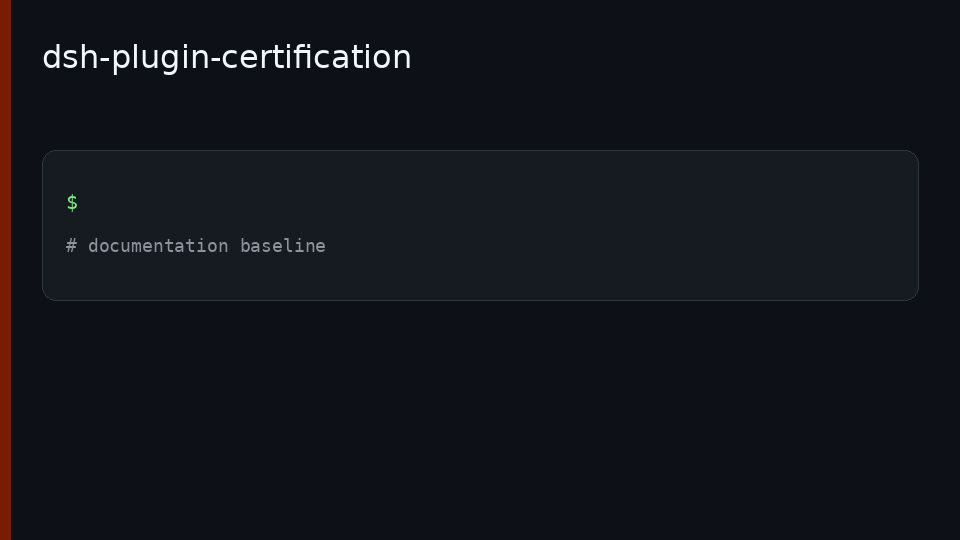

# dsh-certification

Resumen: Community certification registry for DeepSeek Harness plugins.

Esta página es una entrada localizada; la documentación técnica completa está en el README en inglés.

[English](README.md) · [简体中文](README-zh.md) · [Español](README-es.md) · [Português](README-pt.md) · [हिन्दी](README-hi.md)

## Docs

*Repetición animada de una ejecución real registrada en este repositorio.*

[Privacy](PRIVACY.md) · [Security](SECURITY.md) · [Contributing](CONTRIBUTING.md) · [Changelog](CHANGELOG.md)

