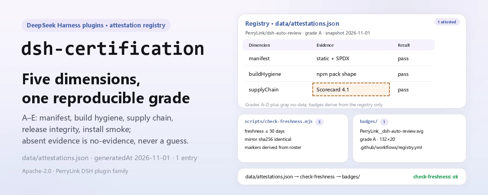

<div align="center">

<picture>
  <source media="(prefers-color-scheme: dark)" srcset="docs/assets/dsh-certification-hero-en-dark.webp">
  
</picture>

# dsh-certification

[English](README.md) · [简体中文](README-zh.md) · [Español](README-es.md) · [Português](README-pt.md) · [हिन्दी](README-hi.md)

</div>

> **Renombrado desde `@perrylink/dsh-plugin-certification`.** Este repositorio ahora es **`dsh-certification`**; el antiguo nombre con scope está obsoleto. No se publica nada en npm.
[](https://dshfind.com/plugins/PerryLink/dsh-certification?ref=badge)

Certificación comunitaria para plugins de DeepSeek Harness: una especificación pública, un modelo de puntuación verificable por máquina y un registro independiente con badges. Este proyecto existe porque la lista canónica del ecosistema dice explícitamente que "no es un juez de la calidad de los plugins" y que "figurar en una lista no es una revisión de seguridad": alguien ajeno a las listas debe ejecutar esa verificación, de forma reproducible y sin arrogarse autoridad sobre ellas.

**Este es un repositorio de datos, no un plugin.** No incluye ningún plugin de Cordis, nada de lo que hay aquí es instalable y nada se publica en npm: `package.json` es `private` y existe solo para que las herramientas del ecosistema puedan leer los metadatos (`dsh.manifestVersion`, `engines.dsh` — el mismo rango de tres cláusulas que `dsh-plugin-kit/data/peer-range.json` registra como canónico, citado literalmente en lugar de reescrito).

<picture>
  <source media="(prefers-color-scheme: dark)" srcset="docs/assets/dsh-certification-flow-v5-dark.svg">
  __<repo>.svg y .github/workflows/registry.yml los vuelve a generar a diario">
</picture>

*Estructura: cinco dimensiones → data/attestations.json → puertas check-freshness → badges. Las etiquetas del diagrama son nombres reales de scripts, rutas y archivos de workflow, por eso una sola imagen sirve para los cinco idiomas.*

## Las cinco dimensiones


*Animación: node scripts/check-freshness.mjs re-ejecutado el 2026-11-21 con DSH_KIT_ROSTER apuntando al checkout del roster dsh-kit — stdout real, sin llamadas de red.*

| Dimensión | Fuente de evidencia | Comprobaciones |
|---|---|---|
| A. Cumplimiento del manifest | Estático | manifest `dsh.bundle`, LICENSE (SPDX), alineación de keywords/topics, READMEs en cinco idiomas, engines |
| B. Higiene de build | Estático | lista de permitidos `files` completa, declaración de dependencias (peer/optional), ausencia de patrones maliciosos en `postinstall`, puertas de lint/typecheck presentes |
| C. Cadena de suministro | OpenSSF Scorecard | las 18 comprobaciones upstream, mediante la API oficial de Scorecard y sus badges |
| D. Integridad de release | npm provenance | atestación SLSA verificable con `npm audit signatures` |
| E. Humo de instalación | registros de dsh-test-drive | instalación/carga/arranque sin claves en un perfil desechable aislado (cuatro estados: `ok` / `load-fail` / `install-fail` / `skip`) |

## Grados

- **A** — pasan las cinco (E debe ser `ok`), sin veto
- **B** — E pasa y al menos tres de A/B/C/D pasan
- **C** — E pasa y el resto queda incompleto
- **D** — falla cualquier puerta dura (falta `dsh.bundle`, no hay licencia, se detecta un patrón malicioso)
- **Veto de seguridad** — código ofuscado, exfiltración de credenciales o comportamiento sorprendente en tiempo de instalación dan D de inmediato, con el motivo publicado
- **E bloqueada por el entorno** — cuando E termina en `install-fail` únicamente por una puerta de entorno no interactivo (por ejemplo, el `approve-builds` interactivo de pnpm que no se puede confirmar en un sandbox), la entrada conserva el grado **B** (si A–D pasan) y registra `environment-blocked` con el comando de reproducción. Las puertas ambientales nunca se registran como `D`.

## Disciplina de evidencia (estructural)

Toda puntuación debe provenir de una ejecución real y reproducible: el resultado de una sonda, una ejecución de Scorecard, una verificación de provenance o un registro de test-drive. La evidencia ausente es `no-evidence`, nunca una suposición. Cada dimensión registra enlaces de auditoría con fecha de snapshot.

## Registro y badges

- `data/attestations.json` — el registro: un registro por repositorio atestado (resultados por dimensión + enlaces de evidencia + versión de la especificación). **CI vuelve a renderizar los badges a partir de él con un cron diario (`.github/workflows/registry.yml`); las entradas del registro son curación humana, no resultado de CI.**
- Los artefactos de badge son los SVG versionados bajo `badges/`, generados por `scripts/badge.mjs` a partir del registro (el registro es la única fuente de verdad; el script nunca inventa un grado).
- **URL de badge funcional** (el nombre del artefacto usa **doble guion bajo** `<owner>__<repo>`):

  ```
  https://raw.githubusercontent.com/PerryLink/dsh-certification/main/badges/<owner>__<repo>.svg
  ```

  Lista para pegar:

  ```markdown
  [](https://github.com/PerryLink/dsh-certification#registry-and-badges)
  ```

- ⚠️ La forma `https://perrylink.github.io/dsh-certification/badge/<owner>/<repo>.svg` se documentó antes de la v0.2 pero **devolvía 404**: este repositorio nunca ha tenido un despliegue de GitHub Pages (`registry.yml` solo renderiza y hace commit de los SVG). No anuncies esa URL hasta que exista realmente un despliegue de Pages; usa la forma raw anterior o habilita Pages y publica `badges/<owner>__<repo>.svg` en `badge/<owner>/<repo>.svg`.
- Grados: A / B / C / D, más un `no-data` gris para todo lo que no esté en el registro.
- Las listas y los marketplaces solo enlazan el badge — su postura de "sin respaldo" no cambia.

## Comprobaciones

`node scripts/check-freshness.mjs` es la puerta de este repositorio (solo módulos integrados de `node:`, cero dependencias) y se ejecuta en cada push, en cada pull request y semanalmente:

- **freshness** — el `generatedAt` del registro y el `snapshot` de cada entrada deben tener como máximo 30 días. La evidencia de certificación obsoleta hace fallar el build en lugar de describir en silencio un plugin como era hace un mes.
- **mirror** — la copia de solo lectura servida por `dsh-cert-mcp` debe contener el mismo contenido de registro que `data/attestations.json`, para que la URL viva del MCP nunca sirva grados que este repositorio ya no respalda. La comparación se hace sobre texto normalizado a LF, porque los dos repositorios son clones separados con su propio `core.autocrlf` y una comparación de bytes crudos reportaría una deriva inexistente. Cuando el repositorio hermano no está presente, la comprobación informa `SKIP` — un "no se comparó nada" explícito, nunca un aprobado.
- **markers** — los dos recuentos del roadmap anterior se contrastan con sus fuentes, para que la prosa no se desvíe del roster.

`DSH_CERT_MIRROR` y `DSH_KIT_ROSTER` sustituyen las rutas de los repositorios hermanos. `.github/workflows/checks.yml` (de solo lectura, `contents: read`) hace checkout de `dsh-cert-mcp` y `dsh-plugin-kit` en `_siblings/` y los pasa mediante esos conmutadores, de modo que las tres aserciones se ejecutan en cada push y pull request además de semanalmente; y los mismos conmutadores son la forma de ejercitar localmente los casos de obsolescencia, deriva, JSON malformado y fuente ausente. El `registry.yml` programado (que necesita `contents: write` para hacer commit de los badges) solo ejecuta la aserción de frescura, ya que ese job no hace checkout de nada más.

## Relación con las herramientas existentes

- `dsh-test-drive` aporta los registros de la dimensión E (dominio `test_drive` ya abierto)
- `dsh-score` consume los registros de certificación como evidencia de instalación
- `dsh-skill-pack-security` aporta la revisión de patrones maliciosos para la dimensión B
- OpenSSF Scorecard aporta la dimensión C entera — este proyecto no la reinventa
- Solapamiento con `dsh-plugin-scorecard`, `dsh-plugin-audit` y similares: la discusión de gobernanza está abierta en [issue #1](../../issues/1); el objetivo es un estándar acordado, no un vigésimo primer evaluador

## Relación con los niveles DSH

Los niveles de adopción DSH se definen fuera de este repositorio, en el proyecto privado `dsh-standards` (un borrador en el momento de escribir esto; pide acceso al mantenedor). Una copia pública de enseñanza se mantiene en [dsh-plugin-guide/guide/standards.md](https://github.com/PerryLink/dsh-plugin-guide/blob/main/guide/standards.md): **DSH-ENTRY** (línea base de compatibilidad), **DSH-FLOW** (adopción recomendada) y **DSH-BOOST** (práctica orientativa). No son los grados de este repositorio y nada aquí los certifica.

- **Grado vs nivel.** `A`/`B`/`C`/`D` es un grado de calidad y evidencia sobre las cinco comprobaciones anteriores; `ENTRY`/`FLOW`/`BOOST` es profundidad de adopción. Los dos ejes son ortogonales: un plugin puede tener grado `A` y aun así tener `FLOW = not-run`.
- **ENTRY.** Las dimensiones A (manifest) y E (humo de instalación) — más un veto de seguridad claro, que es una precondición de este repositorio, no un requisito de ENTRY — son necesarias pero **no suficientes** para ENTRY `runtime`. Las puertas G0–G5 de los estándares siguen decidiendo eso, y este registro no anota ningún resultado de puerta.
- **FLOW y BOOST.** Ninguna dimensión de aquí ejecuta los recorridos J1–J8 ni mide las prácticas LEV-1..LEV-8; ambas figuran como `not-covered` en [`data/standards-crosswalk.json`](./data/standards-crosswalk.json).

El crosswalk completo — qué demuestra cada dimensión, a qué puerta puede alimentar y qué no reclamará este repositorio — está en [`STANDARDS.md`](./STANDARDS.md).

## Hoja de ruta

1. Publicar la especificación v1 (este documento)
2. Registro + CI de badges
> **Actualización del 2026-11-01:** el roster ahora deriva **98** repositorios no-infra — **87 active / 8 frozen / 3 retired** — de `dsh-plugin-kit/data/repos.json` (99 entradas incluida la fila de infraestructura del kit). Los números siguientes están actualizados a esa fuente; la línea anterior de 94 / 86 / 5 / 3 era la base del lote de antes de octubre.

3. Atestar la familia de plugins PerryLink como primer lote base: **98** repositorios de plugins en el roster familiar — **87** mantenidos activamente, **8** congelados y **3** retirados, es decir, todas las entradas cuyo `role` no es `infra` — y **1** atestado hasta ahora. Ambos recuentos se derivan, no se escriben a mano — `scripts/check-freshness.mjs` los contrasta, junto con los números en negrita de esta frase, contra `dsh-plugin-kit/data/repos.json` y contra este registro. <!-- roster-count: 98 --><!-- attested-count: 1 -->
   - ⚠️ **Alcance de estos 98, para que no se lea como el tamaño de la familia** — la tabla autoritativa está en el [README de `dsh-kit`, "Family counts — one definition per number"](https://github.com/PerryLink/dsh-kit#family-counts--one-definition-per-number). Este número es el archivo de roster legible por máquina: 99 entradas allí = estos 98 más la entrada de infraestructura `dsh-plugin-kit`. **No** son las tablas familiares de 45 filas (que conservan las filas retiradas y nunca borran ninguna) ni la lista de especificaciones de instalación (que excluye a los miembros retirados del roster).
4. Pilotar con otros autores de plugins destacados
5. Proponer la visualización del badge a la lista canónica y a los marketplaces (solo enlace, sin respaldo)

**Línea de la familia DSH:** este repositorio pertenece a la **familia de plugins PerryLink DeepSeek Harness**, cuya línea actual es `dsh-v0.2.2-alpha.3`.

## PerryLink DSH Plugin Family

Este proyecto es una de las **88 entradas** de DeepSeek Harness mantenidas activamente por [PerryLink](https://github.com/PerryLink) (87 plugins + la fila de infraestructura del kit). El roster familiar suma **99** entradas en total — **8 congeladas**, **3 retiradas** — y permanece plegado abajo para que cada README conserve una primera pantalla corta. Expándelo para ver cada fila, con el motivo en la columna Estado.

<details>
<summary>Expandir todos los plugins</summary>

| Plugin | Descripción breve | Estado |
|---|---|---|
| **[dsh-aqua-input-check](https://github.com/PerryLink/dsh-aqua-input-check)** | 水产养殖投入品记录核对（按投入品用量、休药期与起捕间隔核对记录自洽，仅提示差异，不作出定性结论） |  |
| **[dsh-archive-check](https://github.com/PerryLink/dsh-archive-check)** | 档案归档完整性与保管期限核对（依据《档案法》及配套规定，仅提示差异，不作出定性结论） |  |
| **[dsh-auto-review](https://github.com/PerryLink/dsh-auto-review)** | Second-model auto-review on the approval chain, fail-closed by default |  |
| **[dsh-autotier](https://github.com/PerryLink/dsh-autotier)** | Automatic strong/cheap model-tier routing with deterministic risk guards and a `/tier` command | 🧊 CONGELADO — ver el README del repositorio |
| **[dsh-background-agents](https://github.com/PerryLink/dsh-background-agents)** | Durable background child agents with a Web UI sidebar, messaging and interrupt | 🚫 RETIRADO — ver el README del repositorio |
| **[dsh-bid-ca-precheck](https://github.com/PerryLink/dsh-bid-ca-precheck)** | 投标文件符合性预检（按招标文件逐条核对响应情况，仅提示差异，不作出定性结论） |  |
| **[dsh-bid-qual-check](https://github.com/PerryLink/dsh-bid-qual-check)** | 投标人资格条件核对（按资格条件与证明材料核对逐条响应，仅提示差异，不作出定性结论） |  |
| **[dsh-budget](https://github.com/PerryLink/dsh-budget)** | Cost governance for DeepSeek Harness: budgets, carbon, and latency in one panel. | 🧊 CONGELADO — ver el README del repositorio |
| **[dsh-cert-mcp](https://github.com/PerryLink/dsh-cert-mcp)** | Read-only MCP server exposing the certification registry: grades, snapshots and five-dimension evidence | 🧊 CONGELADO — ver el README del repositorio |
| **[dsh-check-pack](https://github.com/PerryLink/dsh-check-pack)** | 给合规/审计/质量：一条命令装齐 53 个 PerryLink 合规核查器（Check Pack），覆盖报关、招投标、EHS、医疗、法律、财务等场景。 One-command installer for the 53-checker PerryLink compliance suite. |  |
| **[dsh-checkpoint-rewind](https://github.com/PerryLink/dsh-checkpoint-rewind)** | Claude Code /rewind-equivalent: snapshots, session forks, one-shot restore |  |
| **[dsh-claude-move](https://github.com/PerryLink/dsh-claude-move)** | Migrate Claude Code sessions, memory, skills and CLAUDE.md into DSH | 🧊 CONGELADO — ver el README del repositorio |
| **[dsh-click](https://github.com/PerryLink/dsh-click)** | Cross-platform native desktop control for DeepSeek Harness — Windows first. |  |
| **[dsh-clinic](https://github.com/PerryLink/dsh-clinic)** | Zero-dependency static + sandbox smoke detector for DeepSeek Harness plugins: package-structure gates (R), cordis contract scans (K), keyless-headless sandbox smoke (D), and ecosystem-listing checks (CC). |  |
| **[dsh-codemod](https://github.com/PerryLink/dsh-codemod)** | Plugin-author upgrade skill for DeepSeek Harness, new-generation single package: one corridor index reads the caller peer band and routes it to the matching closed corridor card (dsh 0.1.3-alpha.1 -> 0.1.5-rc.1 and 0.1.5-rc.2 -> 0.1.6-alpha.2), with a zero-dependency seam scanner shipped as a bundle skill and an npx CLI. |  |
| **[dsh-community-bench](https://github.com/PerryLink/dsh-community-bench)** | In-app Community Bench tab for DeepSeek Harness: reads the public, task-conditioned registry and shows the same score everyone sees; no local scoring. | 🧊 CONGELADO — ver el README del repositorio |
| **[dsh-composer-history](https://github.com/PerryLink/dsh-composer-history)** | Terminal-style input history for the web composer: arrows, Ctrl+R search |  |
| **[dsh-contract-stance](https://github.com/PerryLink/dsh-contract-stance)** | 合同条款立场台账核对（按立场、风险等级与退让底线核对台账自洽，仅提示差异，不作出定性结论） |  |
| **[dsh-customs-doc-check](https://github.com/PerryLink/dsh-customs-doc-check)** | 报关单证一致性核对（按公开的报关单填制规范核对单证间字段一致性，仅提示差异，不作出定性结论） |  |
| **[dsh-data-quality](https://github.com/PerryLink/dsh-data-quality)** | Dataset quality checks and citation cross-checks (the optional numeric bridge consumed here) |  |
| **[dsh-defend](https://github.com/PerryLink/dsh-defend)** | Prompt-injection, jailbreak, and secret-leak defense for DeepSeek Harness. | 🧊 CONGELADO — ver el README del repositorio |
| **[dsh-demurrage-ledger](https://github.com/PerryLink/dsh-demurrage-ledger)** | 滞箱费台账核对（按免箱期与费率核对超期天数与金额的自洽性，仅提示差异，不作出定性结论） |  |
| **[dsh-dida](https://github.com/PerryLink/dsh-dida)** | TickTick (Dida365) task bridge for DeepSeek Harness: a session-header task panel (list filter, quick add, complete, delete, due dates, drag reorder), eleven curated ticktick_* tools, and a plugin settings card over the official TickTick MCP endpoint. |  |
| **[dsh-doublecheck](https://github.com/PerryLink/dsh-doublecheck)** | Engineering-discipline guard: requirements grill, test gates, adversary review |  |
| **[dsh-draw](https://github.com/PerryLink/dsh-draw)** | Unified static-image generation routing for DeepSeek Harness. | 🧊 CONGELADO — ver el README del repositorio |
| **[dsh-drill-script-check](https://github.com/PerryLink/dsh-drill-script-check)** | 应急演练脚本核对（按阶段、响应分级、指挥与资源要素核对脚本齐备，仅提示差异，不作出定性结论） |  |
| **[dsh-eia-guide-check](https://github.com/PerryLink/dsh-eia-guide-check)** | 环评导则适用性核对（按要素、导则名称与执行标准核对台账自洽，仅提示差异，不作出定性结论） |  |
| **[dsh-emergency-plan](https://github.com/PerryLink/dsh-emergency-plan)** | 应急预案要素齐备性与条款级页码定位（依据 GB/T 29639-2020 等公开文件，仅提示差异，不作出定性结论） |  |
| **[dsh-essay-rubric-check](https://github.com/PerryLink/dsh-essay-rubric-check)** | 作文量表评分核对（按评分项、原文定位与分值算术核对评分自洽，仅提示差异，不作出定性结论） |  |
| **[dsh-evidence-check](https://github.com/PerryLink/dsh-evidence-check)** | 证据清单齐备性核对（按待证事实与证据要素核对清单自洽，仅提示差异，不作出定性结论） |  |
| **[dsh-export-ctl-check](https://github.com/PerryLink/dsh-export-ctl-check)** | 出口管制物项核对（按管制清单、最终用途与许可证核对台账齐备，仅提示差异，不作出定性结论） |  |
| **[dsh-fast](https://github.com/PerryLink/dsh-fast)** | Read-only performance diagnostics for DeepSeek Harness. |  |
| **[dsh-fmea-table-check](https://github.com/PerryLink/dsh-fmea-table-check)** | FMEA 分析表要素齐备性与风险顺序数一致性核对（按公开的 FMEA 方法标准核对表内自洽，仅提示差异，不作出定性结论） |  |
| **[dsh-forecast-penalty](https://github.com/PerryLink/dsh-forecast-penalty)** | 预测准确率考核核对（按准确率、门槛与考核单价核对考核费用的算术自洽，仅提示差异，不作出定性结论） |  |
| **[dsh-fund-research](https://github.com/PerryLink/dsh-fund-research)** | Deterministic research reports for Chinese public mutual funds |  |
| **[dsh-github-bot](https://github.com/PerryLink/dsh-github-bot)** | GitHub for DeepSeek Harness: PR/issue/repo/file tools, reviews, and CI checks — every write gated by human approval, token never logged. |  |
| **[dsh-gongwen-flow-check](https://github.com/PerryLink/dsh-gongwen-flow-check)** | 公文流转与办理时限核对（按公开的公文处理规范核对环节完整性与时限，仅提示差异，不作出定性结论） |  |
| **[dsh-gongwen-word-check](https://github.com/PerryLink/dsh-gongwen-word-check)** | 公文格式要素核对（按公开的党政机关公文格式标准核对版头与主体要素，仅提示差异，不作出定性结论） |  |
| **[dsh-guard-plan-qc](https://github.com/PerryLink/dsh-guard-plan-qc)** | 劳动保护与安全防护用品配置表核对（按公开的配备标准核对品名规格与配置数量，仅提示差异，不作出定性结论） |  |
| **[dsh-hazchem-check](https://github.com/PerryLink/dsh-hazchem-check)** | 危险化学品临界量与重大危险源辨识核对（按储存量与临界量核对台账自洽，仅提示差异，不作出定性结论） |  |
| **[dsh-hazplan-check](https://github.com/PerryLink/dsh-hazplan-check)** | HAZOP 分析表要素齐备性与偏差推导一致性核对（依据公开的危险与可操作性分析标准，仅提示差异，不作出定性结论） |  |
| **[dsh-hidden-risk-map](https://github.com/PerryLink/dsh-hidden-risk-map)** | 安全隐患台账→《工贸企业重大事故隐患判定标准》（应急管理部令第10号）条款映射提示（仅提示差异，不作出定性结论） |  |
| **[dsh-hs-classify](https://github.com/PerryLink/dsh-hs-classify)** | 商品归类层级一致性核对（按章、品目、子目与商品编号的层级关系核对自洽，仅提示差异，不作出定性结论） |  |
| **[dsh-icd-rule-check](https://github.com/PerryLink/dsh-icd-rule-check)** | ICD 合并编码与星剑号配对提示（依据 GB/T 14396-2016 与公开的 ICD 使用说明，仅提示差异，不作出定性结论） |  |
| **[dsh-industry-research](https://github.com/PerryLink/dsh-industry-research)** | Industry research orchestration that seals its deliverables through this plugin's `ctx.researchReport.assemble` |  |
| **[dsh-lawcite-adapter](https://github.com/PerryLink/dsh-lawcite-adapter)** | 法条引用与文书要素核对（按名称、条号、原文与效力状态核对引用可核验性，仅提示差异，不作出定性结论） |  |
| **[dsh-laya](https://github.com/PerryLink/dsh-laya)** | Laya typed decisions (`noul`/`choice`/`score`) as a first-class Cordis service and model-visible tools |  |
| **[dsh-lc-doc-check](https://github.com/PerryLink/dsh-lc-doc-check)** | 信用证单据条款核对（按单据种类、份数、期限与不符点核对交单自洽，仅提示差异，不作出定性结论） |  |
| **[dsh-learning-gap-check](https://github.com/PerryLink/dsh-learning-gap-check)** | 能力差距与培养计划核对（按能力等级差、培养措施与完成期限核对台账闭环，仅提示差异，不作出定性结论） |  |
| **[dsh-library](https://github.com/PerryLink/dsh-library)** | Local document knowledge base for DeepSeek Harness. |  |
| **[dsh-local-ai](https://github.com/PerryLink/dsh-local-ai)** | Local-model (Ollama) integration for DeepSeek Harness. |  |
| **[dsh-lsp-actions](https://github.com/PerryLink/dsh-lsp-actions)** | LSP diagnostics, formatting, completion, code actions and rename over language servers |  |
| **[dsh-mask](https://github.com/PerryLink/dsh-mask)** | PII masking middleware: anonymize at the model boundary, restore at the display layer |  |
| **[dsh-mcp-panel](https://github.com/PerryLink/dsh-mcp-panel)** | Read-only MCP runtime panel: /mcp command + Settings tab with status, tools and errors |  |
| **[dsh-medrec-qc](https://github.com/PerryLink/dsh-medrec-qc)** | 病案首页形式质控与逻辑矛盾提示（依据国卫办医发〔2016〕24号等公开文件，仅提示差异，不作出定性结论） |  |
| **[dsh-memento](https://github.com/PerryLink/dsh-memento)** | Approval-gated cross-session memory: ctx.memory seam + SQLite + memory tool |  |
| **[dsh-nsfc-form-check](https://github.com/PerryLink/dsh-nsfc-form-check)** | 国家自然科学基金申请书形式审查与匿名化提示（依据《国家自然科学基金条例》与申请人导入的当年指南，仅提示差异，不作出定性结论） |  |
| **[dsh-nurse-record-check](https://github.com/PerryLink/dsh-nurse-record-check)** | 护理记录时限、签名与评估表完整性校验（依据《病历书写基本规范》等公开文件，仅提示差异，不作出定性结论） |  |
| **[dsh-observe](https://github.com/PerryLink/dsh-observe)** | OpenTelemetry and Langfuse observability exporter for DeepSeek Harness. |  |
| **[dsh-origin-rvc-check](https://github.com/PerryLink/dsh-origin-rvc-check)** | 原产地区域价值成分核对（按 RVC 定义式与门槛核对原产地判定自洽，仅提示差异，不作出定性结论） |  |
| **[dsh-ota-review-check](https://github.com/PerryLink/dsh-ota-review-check)** | 在线点评回复台账核对（按回复时限、问题分类与整改状态核对台账闭环，仅提示差异，不作出定性结论） |  |
| **[dsh-output-styles](https://github.com/PerryLink/dsh-output-styles)** | Claude Code outputStyles-equivalent runtime style switching |  |
| **[dsh-paper-doc-adapter](https://github.com/PerryLink/dsh-paper-doc-adapter)** | 试卷解析结构核对（按题型、答案、分值与 yotta 标识核对试卷结构自洽，仅提示差异，不作出定性结论） |  |
| **[dsh-param-repair](https://github.com/PerryLink/dsh-param-repair)** | Map request parameters across 11 vendor dialects and repair malformed JSON tool output with deterministic, auditable rules. No network, no model call, no invented data. |  |
| **[dsh-permission-rules](https://github.com/PerryLink/dsh-permission-rules)** | Claude Code-style declarative allow/deny/ask permission rules with audit |  |
| **[dsh-permit-report-check](https://github.com/PerryLink/dsh-permit-report-check)** | 行政许可办理核对（按申请材料、法定时限与决定记录核对台账闭环，仅提示差异，不作出定性结论） |  |
| **[dsh-phocinae](https://github.com/PerryLink/dsh-phocinae)** | Local non-generative decision layer for DeepSeek Harness: phocinae_ask / phocinae_gate tools plus a fail-closed approval gate |  |
| **[dsh-phone-inbox](https://github.com/PerryLink/dsh-phone-inbox)** | The session's inbound phone (WeChat bridge) attachment inbox: list the attachments this conversation actually received and adopt one into the workspace on demand. |  |
| **[dsh-pipeline-check](https://github.com/PerryLink/dsh-pipeline-check)** | 项目全流程文件链条核对（按环节先后与金额口径核对链条自洽，仅提示差异，不作出定性结论） |  |
| **[dsh-pleading-draft](https://github.com/PerryLink/dsh-pleading-draft)** | 起诉状要素齐备性核对（按诉请、事实、证据、法条四要素核对文书齐备，仅提示差异，不作出定性结论） |  |
| **[dsh-policy-brief-draft](https://github.com/PerryLink/dsh-policy-brief-draft)** | 政策专报要素核对（按观点、依据、出处与建议核对专报齐备，仅提示差异，不作出定性结论） |  |
| **[dsh-power-loss-split](https://github.com/PerryLink/dsh-power-loss-split)** | 线损电量拆分与考核表核对（依据公开的线损计算口径，仅提示差异，不作出定性结论） |  |
| **[dsh-power-ticket-check](https://github.com/PerryLink/dsh-power-ticket-check)** | 电力工作票要素齐备性与签发许可顺序核对（依据现行电力安全工作规程，仅提示差异，不作出定性结论） |  |
| **[dsh-ppap-check](https://github.com/PerryLink/dsh-ppap-check)** | PPAP 提交要素齐备性核对（按公开的 PPAP 手册与提交等级核对要素齐备与版本填写，仅提示差异，不作出定性结论） |  |
| **[dsh-primer](https://github.com/PerryLink/dsh-primer)** | The DSH plugin development guide as an installable skill: packaging, contracts, checks, and a pack verifier for builds. |  |
| **[dsh-protest-deadline](https://github.com/PerryLink/dsh-protest-deadline)** | 质疑与投诉期限核对（按公开的政府采购质疑投诉规定核对期限与台账自洽，仅提示差异，不作出定性结论） |  |
| **[dsh-railway-window](https://github.com/PerryLink/dsh-railway-window)** | 铁路施工天窗台账核对（按时间窗、时长算术与命令号核对台账自洽，仅提示差异，不作出定性结论） |  |
| **[dsh-reach](https://github.com/PerryLink/dsh-reach)** | Multi-channel approval/question bridge: WeChat/Telegram/Feishu, session console | 🧊 CONGELADO — ver el README del repositorio |
| **[dsh-repair-order-qc](https://github.com/PerryLink/dsh-repair-order-qc)** | 维修工单结算核对（按项目金额、配件工时合计与结算总额核对算术自洽，仅提示差异，不作出定性结论） |  |
| **[dsh-research-report](https://github.com/PerryLink/dsh-research-report)** | Verifiable research-report engine: content-addressed evidence ledger and sealed versions |  |
| **[dsh-review-reply-check](https://github.com/PerryLink/dsh-review-reply-check)** | 审稿意见逐条回应覆盖核对（按意见与回应一一对应核对覆盖完整性，仅提示差异，不作出定性结论） |  |
| **[dsh-rulefile-check](https://github.com/PerryLink/dsh-rulefile-check)** | 规则库文件自检核对（按条款引用纪律与效力上限核对规则库自身合规，仅提示差异，不作出定性结论） |  |
| **[dsh-safety-brief-check](https://github.com/PerryLink/dsh-safety-brief-check)** | 安全技术交底记录要素齐备性与签字闭环核对（依据公开的安全生产法规与检查标准，仅提示差异，不作出定性结论） |  |
| **[dsh-scaffold](https://github.com/PerryLink/dsh-scaffold)** | Shared zero-runtime-dependency toolkit for PerryLink DSH plugins: a pluggable Provider registry seam, fail-closed approval and adaptive session-event gates, mechanical verify scripts, shared sanitize/pricing/judge modules, and a new-plugin skeleton. |  |
| **[dsh-score](https://github.com/PerryLink/dsh-score)** | Multi-dimensional quality scoring for DeepSeek Harness plugins. |  |
| **[dsh-security-pack](https://github.com/PerryLink/dsh-security-pack)** | Security skill-pack provider: pre-packaged security review skills with a risk card; ships both host and client faces. |  |
| **[dsh-session-pin](https://github.com/PerryLink/dsh-session-pin)** | Pin sessions in the Web sidebar with durable ordering | 🚫 RETIRADO — ver el README del repositorio |
| **[dsh-session-sync](https://github.com/PerryLink/dsh-session-sync)** | Cross-device session sync for DeepSeek Harness — a dedicated git mirror of your session store. |  |
| **[dsh-site-log-check](https://github.com/PerryLink/dsh-site-log-check)** | 监理日志跨日连续性与旁站覆盖提示（依据 GB/T 50319-2013 等公开文件，仅提示差异，不作出定性结论） |  |
| **[dsh-soe-decision-check](https://github.com/PerryLink/dsh-soe-decision-check)** | 三重一大决策台账核对（按前置研究、会议审议与决议记录核对程序留痕，仅提示差异，不作出定性结论） |  |
| **[dsh-soilwater-check](https://github.com/PerryLink/dsh-soilwater-check)** | 土壤与地下水监测台账核对（按点位、监测项目、限值与超标判定核对台账自洽，仅提示差异，不作出定性结论） |  |
| **[dsh-sop-sync-check](https://github.com/PerryLink/dsh-sop-sync-check)** | 作业规程与 FMEA／控制计划一致性核对（按编号与版本核对三份文件是否同步，仅提示差异，不作出定性结论） |  |
| **[dsh-spc-gbt-adapter](https://github.com/PerryLink/dsh-spc-gbt-adapter)** | 控制图常数与过程能力指数核对（按 GB/T 4091 的常规控制图常数表核对控制限与 Cp/Cpk 的自洽性，仅提示差异，不作出定性结论） |  |
| **[dsh-talk](https://github.com/PerryLink/dsh-talk)** | Voice-first session loop for DeepSeek Harness: talk to it, hear it answer. |  |
| **[dsh-team-rooms](https://github.com/PerryLink/dsh-team-rooms)** | Cross-session team rooms: shared message bus, task board and timeline | 🚫 RETIRADO — ver el README del repositorio |
| **[dsh-tender-extract](https://github.com/PerryLink/dsh-tender-extract)** | 招标文件条款摘录核对（按出处与原文逐字核对摘录完整性，仅提示差异，不作出定性结论） |  |
| **[dsh-tender-matrix](https://github.com/PerryLink/dsh-tender-matrix)** | 评标因素评分矩阵核对（按分值上限与合计核对矩阵自洽，仅提示差异，不作出定性结论） |  |
| **[dsh-test-drive](https://github.com/PerryLink/dsh-test-drive)** | Isolated install-and-smoke test drives for DeepSeek Harness plugins. |  |
| **[dsh-warranty-calc](https://github.com/PerryLink/dsh-warranty-calc)** | 质保期与索赔金额核对（按质保期月数与里程、索赔金额算式核对自洽，仅提示差异，不作出定性结论） |  |

</details>


## Licencia

MIT. Véase [LICENSE](./LICENSE).


## Datos HCB

[HCB](https://github.com/PerryLink/dsh-hcb) 0.12.0 — **136 checked + 7 tested / 3 FLOW `manual` / gate 2 blocked · 31 review · 109 pilot · 1 `production-candidate`** — checker **143/143 filas en `dsh-standards@1.7.0`** — es la fuente canónica de compatibilidad / tracks / riesgo declarados. Las 7 filas probadas son `dsh-plugin-guide@0.5.9` (el único production-candidate) más `dsh-budget@0.4.26`, `dsh-defend@0.3.28`, `dsh-mask@0.2.25`, `dsh-memento@0.5.31`, `dsh-observe@0.2.28`, `dsh-test-drive@0.3.26`; las otras 136 filas no están probadas, así que esto no hace que el roster esté listo para producción. El registro puede enlazar filas de HCB; **la certificación A–D y la puerta HCB son ortogonales**.
