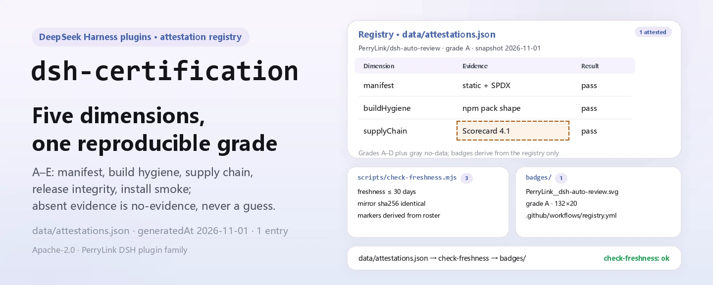
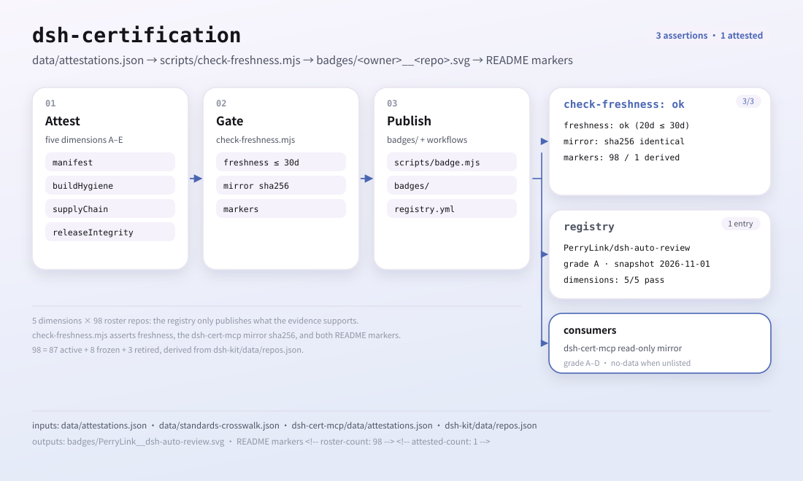

<picture>
  <source media="(prefers-color-scheme: dark)" srcset="docs/assets/dsh-certification-hero-en-dark.webp">
  
</picture>

# dsh-certification

DeepSeek Harness प्लगइन के लिए सामुदायिक प्रमाणन रजिस्ट्री: सार्वजनिक विनिर्देश, मशीन-जाँचने योग्य स्कोरिंग मॉडल और बैज वाली स्वतंत्र रजिस्ट्री।

[English](README.md) · [简体中文](README-zh.md) · [Español](README-es.md) · [Português](README-pt.md) · [हिन्दी](README-hi.md)

> यह फ़ाइल हिन्दी स्थानीयकृत प्रवेश है; पूरा तकनीकी विवरण अंग्रेज़ी [README.md](README.md) में है और यहाँ दोहराया नहीं गया है।

<picture>
  <source media="(prefers-color-scheme: dark)" srcset="docs/assets/dsh-certification-flow-v5-dark.svg">
  __<repo>.svg बनाता है और .github/workflows/registry.yml उन्हें प्रतिदिन फिर से रेंडर करता है">
</picture>

*संरचना: पाँच आयाम → data/attestations.json → check-freshness गेट → badges। चित्र के लेबल असली स्क्रिप्ट नाम, पथ और workflow फ़ाइलें हैं, इसलिए एक ही चित्र पाँचों भाषाओं के लिए है।*

## पाँच आयाम

*एनिमेशन: 2026-11-21 को DSH_KIT_ROSTER के साथ node scripts/check-freshness.mjs का दोबारा रन — असली stdout, कोई नेटवर्क कॉल नहीं।*

A–E में manifest, build hygiene, supply chain (OpenSSF Scorecard), release integrity (npm provenance) और install smoke (`dsh-test-drive` रिकॉर्ड, चार स्थितियाँ `ok` / `load-fail` / `install-fail` / `skip`) आते हैं; पूरे मानदंड अंग्रेज़ी [README.md](README.md) के The five dimensions सेक्शन में हैं।

## ग्रेड

`A` / `B` / `C` / `D` और धूसर `no-data`: E का `ok` होना ज़रूरी है, कोई भी कठोर गेट विफल हो तो D, और सुरक्षा वीटो तुरंत D; पर्यावरण से अवरुद्ध E `environment-blocked` दर्ज करता है और B रखता है; पूरे नियम अंग्रेज़ी README के Grades सेक्शन में हैं।

## साक्ष्य अनुशासन (मूलभूत)

हर स्कोर वास्तविक, दोबारा चलाए जा सकने वाले निष्पादन से आना चाहिए — प्रोब परिणाम, Scorecard रन, provenance जाँच या test-drive रिकॉर्ड; साक्ष्य न होने पर `no-evidence`, कभी अनुमान नहीं; हर आयाम स्नैपशॉट तिथि के साथ ऑडिट लिंक दर्ज करता है।

## रजिस्ट्री और बैज

`data/attestations.json` ही पूरी रजिस्ट्री है और `badges/<owner>__<repo>.svg` को `scripts/badge.mjs` बनाता है (रजिस्ट्री ही एकमात्र स्रोत है); `.github/workflows/registry.yml` रोज़ फिर से रेंडर करता है; चिपकाने योग्य badge URL और 404 चेतावनी अंग्रेज़ी README में है।

## गेट

`node scripts/check-freshness.mjs` तीन चीज़ें जाँचता है: साक्ष्य 30 दिन से पुराना न हो, इस रजिस्ट्री और `dsh-cert-mcp` मिरर का sha256 समान हो, और README के roster-count/attested-count marker `dsh-kit/data/repos.json` से निकले मानों से मिलें; असली रन ऊपर के एनिमेशन में है।

## मौजूदा टूल से संबंध

`dsh-test-drive` आयाम E के रिकॉर्ड देता है, `dsh-score` प्रमाणन रिकॉर्ड उपभोग करता है, `dsh-skill-pack-security` आयाम B के दुर्भावनापूर्ण पैटर्न की जाँच देता है और OpenSSF Scorecard पूरा आयाम C देता है; `dsh-plugin-scorecard` आदि से ओवरलैप issue #1 में चर्चित है।

## DSH स्तरों से संबंध

`A`/`B`/`C`/`D` गुणवत्ता और साक्ष्य का ग्रेड है; `DSH-ENTRY` / `DSH-FLOW` / `DSH-BOOST` अपनाने की गहराई है। दोनों अक्ष लंबवत हैं: यह रजिस्ट्री G0–G5 या J1–J8 का परिणाम दर्ज नहीं करती; पूरा crosswalk अंग्रेज़ी README और `STANDARDS.md` में है।

## रोडमैप

spec v1 और रजिस्ट्री/बैज CI पूरे हो चुके हैं; परिवार का आधार बैच 98 गैर-infra रिपॉज़िटरी है (87 active / 8 frozen / 3 retired), जिनमें 1 सत्यापित है; संख्याएँ गेट से सिद्ध होती हैं, हाथ से नहीं लिखी जातीं; पूरा 5-चरणीय रोडमैप अंग्रेज़ी README में है।

## PerryLink DSH प्लगइन परिवार

यह रिपॉज़िटरी [PerryLink](https://github.com/PerryLink) के DeepSeek Harness प्लगइन परिवार का हिस्सा है; पूरा (विस्तार-योग्य) रोस्टर अंग्रेज़ी [README.md](README.md) में है।

## लाइसेंस

MIT। देखें [LICENSE](./LICENSE)।

## HCB डेटा

`dsh-hcb` 0.12.0 घोषित संगतता, tracks और जोखिम का प्रामाणिक स्रोत है (136 checked + 7 tested, 3 FLOW `manual`, gate 2 blocked); प्रमाणन A–D और HCB गेट लंबवत हैं; अंग्रेज़ी README का HCB data सेक्शन देखें।

[Privacy](PRIVACY.md) · [Security](SECURITY.md) · [Contributing](CONTRIBUTING.md) · [Changelog](CHANGELOG.md)
