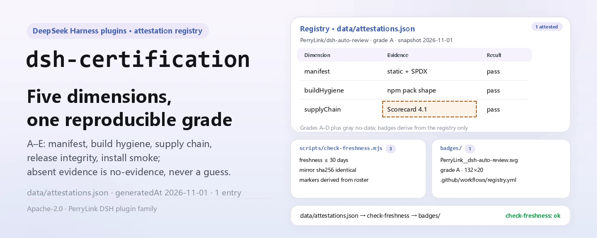
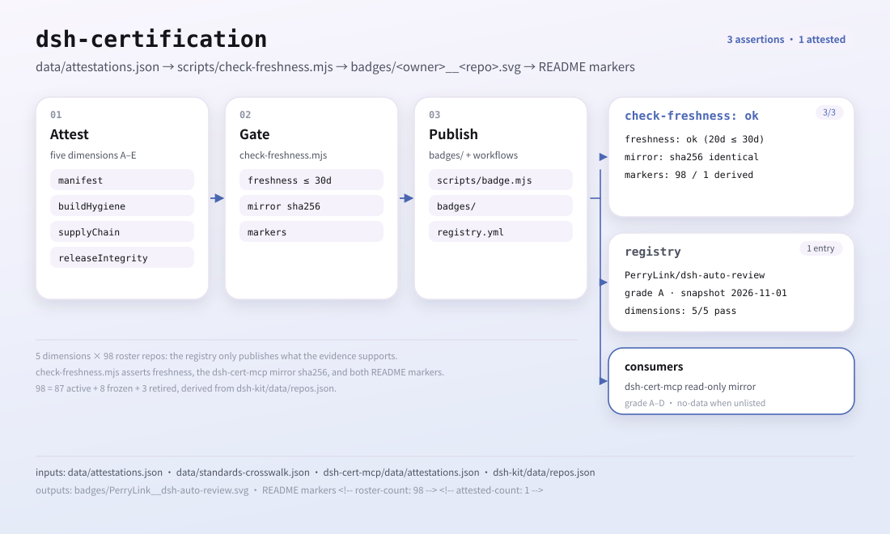

<picture>
  <source media="(prefers-color-scheme: dark)" srcset="docs/assets/dsh-certification-hero-en-dark.webp">
  
</picture>

# dsh-certification

Registro comunitário de certificação para plugins do DeepSeek Harness: especificação pública, modelo de pontuação verificável por máquina e um registro independente com badges.

[English](README.md) · [简体中文](README-zh.md) · [Español](README-es.md) · [Português](README-pt.md) · [हिन्दी](README-hi.md)

> Este arquivo é a entrada localizada em português; o corpo técnico completo está no [README.md](README.md) em inglês e não é repetido aqui.

<picture>
  <source media="(prefers-color-scheme: dark)" srcset="docs/assets/dsh-certification-flow-v5-dark.svg">
  __<repo>.svg e .github/workflows/registry.yml os re-renderiza diariamente">
</picture>

*Estrutura: cinco dimensões → data/attestations.json → portões check-freshness → badges. Os rótulos do diagrama são nomes reais de script, caminhos e arquivos de workflow, então uma única imagem serve aos cinco idiomas.*

## As cinco dimensões

*Animação: node scripts/check-freshness.mjs reexecutado em 2026-11-21 com DSH_KIT_ROSTER apontando para o checkout do roster dsh-kit — stdout real, sem chamadas de rede.*

A–E cobrem manifest, higiene de build, cadeia de suprimentos (OpenSSF Scorecard), integridade de release (npm provenance) e fumaça de instalação (registros do `dsh-test-drive`, quatro estados `ok` / `load-fail` / `install-fail` / `skip`); os critérios completos estão na seção The five dimensions do [README.md](README.md) em inglês.

## Graus

`A` / `B` / `C` / `D` mais um `no-data` cinza: E deve ser `ok`, qualquer portão rígido falho é D, e um veto de segurança leva a D imediatamente; um E bloqueado pelo ambiente registra `environment-blocked` e mantém B; as regras completas estão na seção Grades do README em inglês.

## Disciplina de evidência (estrutural)

Toda pontuação deve vir de execução real e reprodutível — resultado de sonda, execução do Scorecard, verificação de provenance ou registro de test-drive; evidência ausente é `no-evidence`, nunca um palpite; cada dimensão guarda links de auditoria com data de snapshot.

## Registro e badges

`data/attestations.json` é o registro completo e `badges/<owner>__<repo>.svg` é gerado por `scripts/badge.mjs` (o registro é a única fonte de verdade); `.github/workflows/registry.yml` os re-renderiza diariamente; a URL de badge colável e o aviso de 404 estão no README em inglês.

## Portões

`node scripts/check-freshness.mjs` verifica três coisas: evidência de no máximo 30 dias, sha256 idêntico entre este registro e o espelho do `dsh-cert-mcp`, e os marcadores roster-count/attested-count do README derivados de `dsh-kit/data/repos.json`; a execução real está na animação acima.

## Relação com ferramentas existentes

`dsh-test-drive` fornece os registros da dimensão E, `dsh-score` consome os registros de certificação, `dsh-skill-pack-security` fornece a triagem de padrões maliciosos da dimensão B e o OpenSSF Scorecard fornece a dimensão C inteira; a sobreposição com `dsh-plugin-scorecard` e outros é discutida na issue #1.

## Relação com os níveis DSH

`A`/`B`/`C`/`D` é um grau de qualidade e evidência; `DSH-ENTRY` / `DSH-FLOW` / `DSH-BOOST` é profundidade de adoção. Os dois eixos são ortogonais: este registro não anota resultados G0–G5 nem J1–J8; o crosswalk completo está no README em inglês e em `STANDARDS.md`.

## Roteiro

A spec v1 e a CI de registro/badges já estão no ar; o lote base da família são 98 repositórios não-infra (87 active / 8 frozen / 3 retired), com 1 atestado; os números são afirmados pelo portão, não pela prosa; o roteiro de 5 passos está no README em inglês.

## Família de plugins PerryLink DSH

Este repositório faz parte da família de plugins do DeepSeek Harness da [PerryLink](https://github.com/PerryLink); o roster completo (expansível) está no [README.md](README.md) em inglês.

## Licença

MIT. Veja [LICENSE](./LICENSE).

## Dados HCB

`dsh-hcb` 0.12.0 é a fonte canônica de compatibilidade, tracks e risco declarados (136 checked + 7 tested, 3 FLOW `manual`, gate 2 blocked); a certificação A–D e o portão HCB são ortogonais; veja a seção HCB data do README em inglês.

[Privacy](PRIVACY.md) · [Security](SECURITY.md) · [Contributing](CONTRIBUTING.md) · [Changelog](CHANGELOG.md)
