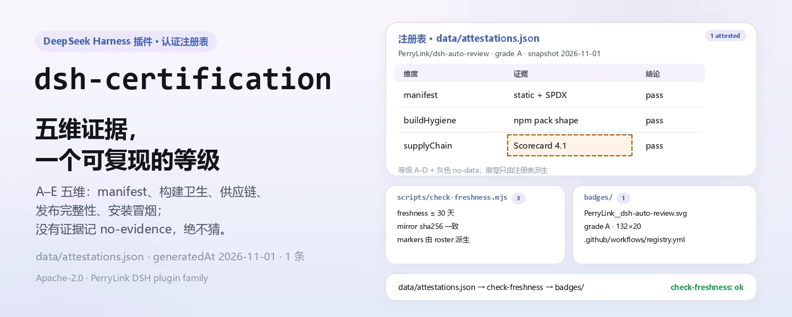
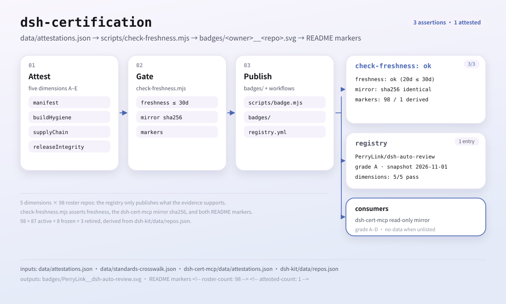
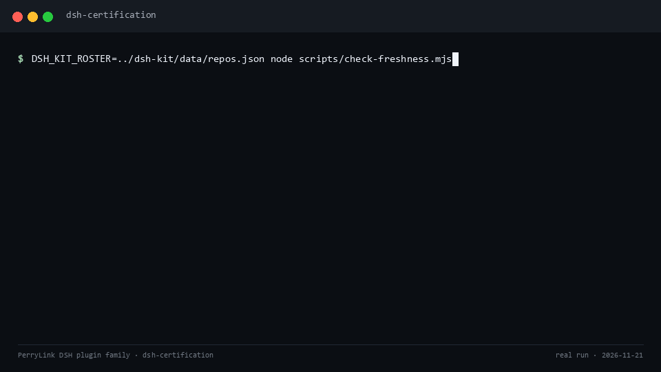

<picture>
  <source media="(prefers-color-scheme: dark)" srcset="docs/assets/dsh-certification-hero-zh-dark.webp">
  
</picture>

# dsh-certification

DeepSeek Harness 插件的社区认证注册表：公开规范、机器可校验的评分模型，以及带徽章的独立注册表。

[English](README.md) · [简体中文](README-zh.md) · [Español](README-es.md) · [Português](README-pt.md) · [हिन्दी](README-hi.md)

> 本文件是简体中文本地化入口；完整技术文档以英文 [README.md](README.md) 为准，正文不在此重复翻译。

<picture>
  <source media="(prefers-color-scheme: dark)" srcset="docs/assets/dsh-certification-flow-v5-dark.svg">
  __<repo>.svg，.github/workflows/registry.yml 每日重渲染">
</picture>

*结构：五个维度 → data/attestations.json → check-freshness 门禁 → 徽章。图内是真实脚本名、路径与 workflow 文件，五语共用一张图。*

## 五个维度

*动图是本仓库门禁于 2026-11-21 的复跑：DSH_KIT_ROSTER 指向 dsh-kit 名册副本，执行 node scripts/check-freshness.mjs。真实 stdout，不联网。*

A–E 分别对应 manifest 合规、构建卫生、供应链（OpenSSF Scorecard）、发布完整性（npm provenance）与安装冒烟（`dsh-test-drive` 记录，四态 `ok` / `load-fail` / `install-fail` / `skip`）；完整判据见英文 [README.md](README.md) 的 The five dimensions 一节。

## 等级

`A` / `B` / `C` / `D` 四级加灰色 `no-data`：E 必须为 `ok`，任一硬门失败即 D，安全否决立即 D 并在发布理由里写明；环境阻塞的 E 记 `environment-blocked` 且保留 B；完整规则见英文 README 的 Grades 一节。

## 证据纪律（承重）

每个分数都必须来自真实、可复现的执行——探针结果、Scorecard 运行、provenance 校验或 test-drive 记录；没有证据记 `no-evidence`，绝不猜；每个维度都记录带快照日期的审计链接。

## 注册表与徽章

`data/attestations.json` 是唯一注册表，`badges/<owner>__<repo>.svg` 由 `scripts/badge.mjs` 生成（注册表是唯一真源，脚本不造等级），`.github/workflows/registry.yml` 每日重渲染；可粘贴徽章 URL 与 404 提醒见英文 README。

## 门禁

`node scripts/check-freshness.mjs` 断言三件事：证据不超过 30 天、`dsh-cert-mcp` 镜像与本注册表 sha256 一致、README 的 roster-count/attested-count marker 与 `dsh-kit/data/repos.json` 派生值一致；本机实跑输出见上方动图。

## 与既有工具的关系

`dsh-test-drive` 提供 E 维记录，`dsh-score` 消费认证记录，`dsh-skill-pack-security` 提供 B 维恶意模式筛查，OpenSSF Scorecard 整体提供 C 维；与 `dsh-plugin-scorecard` 等的重叠在 issue #1 讨论，目标是统一标准而不是再造第二十一个评分器。

## 与 DSH 等级的关系

`A`/`B`/`C`/`D` 是质量与证据等级，`DSH-ENTRY` / `DSH-FLOW` / `DSH-BOOST` 是采用深度；两轴正交，注册表不记录 G0–G5 或 J1–J8 的结果，完整 crosswalk 见英文 README 与 `STANDARDS.md`。

## 路线图

spec v1 与注册表/徽章 CI 已落地；家族基线批次为 98 个非 infra 仓（87 active / 8 frozen / 3 retired），其中 1 个已认证，数字由门禁断言而非手写；完整 5 步路线图见英文 README。

## PerryLink DSH 插件家族

本仓属于 [PerryLink](https://github.com/PerryLink) 的 DeepSeek Harness 插件家族；可展开的完整家族名册在英文 [README.md](README.md) 中。

## 许可证

MIT。见 [LICENSE](./LICENSE)。

## HCB 数据

`dsh-hcb` 0.12.0 是声明兼容性／轨道／风险的规范来源（136 checked + 7 tested，3 FLOW `manual`，gate 2 blocked）；认证 A–D 与 HCB gate 正交，详见英文 README 的 HCB data 一节。

[Privacy](PRIVACY.md) · [Security](SECURITY.md) · [Contributing](CONTRIBUTING.md) · [Changelog](CHANGELOG.md)
